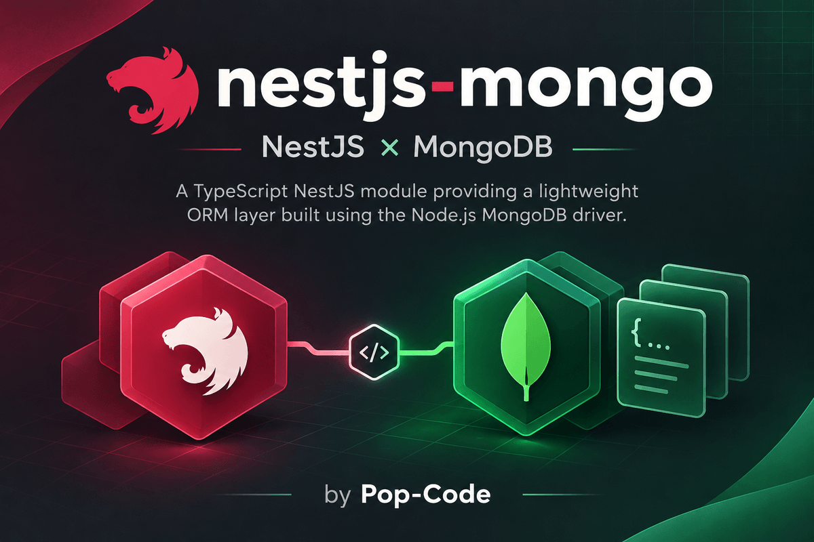

# nestjs-mongo



[](https://github.com/Pop-Code/nestjs-mongo/actions/workflows/test.yml)
[][npm]
[](https://codecov.io/gh/Pop-Code/nestjs-mongo)

A small ORM-like module for [NestJS](https://nestjs.com), built with TypeScript on top of the official [mongodb driver](https://www.mongodb.com/docs/drivers/node/current/).

- Models as classes, validated with class-validator on save, with embedded documents (`@Embedded`)
- An entity manager per connection, and an injectable repository per model
- Typed queries and updates: `find`, `findById`, `findOneOrFail`, `exists`, `distinct`, `aggregate`, `updateOne`, `updateMany`, `findOneAndUpdate`, `upsert`, `bulkWrite`, `insertMany`
- Partial updates (`patch`), optimistic locking (`@Version`), soft delete (`@DeletedAt`)
- Lifecycle hooks (`@BeforeInsert`, `@AfterUpdate`, `@AfterLoad`, ...)
- Relationships with validation, cascade delete, and loading in one query (`populate`, `findWithRelationships`)
- Transactions shared by all the operations of a request, and `@Transactional()` methods
- Pagination (`paginate`, `paginateByCursor`)
- `@Index` (property and compound indexes, index synchronization), `@IsUnique`, and a `$jsonSchema` validator generated from the validation decorators
- Migrations (`MigrationRunner`, and the `nestjs-mongo migrate up|down|status` command line)
- NestJS exceptions: `EntityNotFoundException`, `DuplicateKeyException`, `OptimisticLockException`, `EntityValidationException`
- A `@nestjs/terminus` health indicator (`nestjs-mongo/terminus`)
- Testing helpers: an in-memory replica set, a testing module, fixtures (`nestjs-mongo/testing`)
- Change streams, route parameter pipes, serialization helpers

It does not hide the driver: queries are plain mongodb filters, and cursors are native cursors.

## Requirements

| nestjs-mongo | NestJS     | mongodb driver | MongoDB server | Node.js  |
| ------------ | ---------- | -------------- | -------------- | -------- |
| 0.17.x       | 10, 11, 12 | 7.x            | 4.4 to 9.0     | >= 22.12 |
| 0.16.x       | 10, 11, 12 | 7.x            | 4.4 to 9.0     | >= 22.12 |
| 0.15.x       | 11         | 6.x            | 4.0 to 8.0     | >= 20    |
| 0.14.x       | 8, 9       | 4.x            | 3.6 to 6.0     | >= 14    |

Transactions and change streams require a replica set.

## Install

```bash
npm install nestjs-mongo mongodb class-validator
# or
yarn add nestjs-mongo mongodb class-validator
```

## Quick start

```ts
// app.module.ts
@Module({
    imports: [
        MongoModule.forRoot({ uri: 'mongodb://localhost:27017/my-app' }),
        MongoModule.forFeature({ models: [User] })
    ],
    providers: [UserService]
})
export class AppModule {}

// user.entity.ts
@Collection('users')
export class User extends Entity {
    @IsEmail()
    @IsUnique()
    email: string;

    @IsString()
    name: string;
}

// user.service.ts
@Injectable()
export class UserService {
    constructor(@InjectEntityRepository(User) private readonly users: EntityRepository<User>) {}

    async register(email: string, name: string) {
        return await this.users.save(this.users.fromPlain({ email, name })); // validated, then inserted
    }

    async findByEmail(email: string) {
        return await this.users.findOne({ email }); // a User instance, or undefined
    }

    async rename(id: string, name: string) {
        const user = await this.users.findOneOrFail({ _id: new ObjectId(id) }); // 404 when not found
        return await this.users.patch(user, { name }); // validated, then only name is written
    }
}
```

## Documentation

- [Wiki](https://github.com/Pop-Code/nestjs-mongo/wiki)
- [API](https://pop-code.github.io/nestjs-mongo)
- [Changelog](https://github.com/Pop-Code/nestjs-mongo/blob/master/CHANGELOG.md)

## Development

```bash
yarn install
docker run -d --name mongo -p 27017:27017 mongo:8.0 --replSet test-rs
docker exec mongo mongosh --quiet --eval 'rs.initiate({_id:"test-rs",members:[{_id:0,host:"localhost:27017"}]})'
yarn lint && yarn build && yarn test
yarn doc # regenerate the API reference in ./docs
```

The tests use `mongodb://localhost:27017` (see `test/constants.ts`) and need Node.js >= 24.9 (Jest loads the ESM-only NestJS 12 packages).
See [RELEASING.md](./RELEASING.md) to publish a version.

[npm]: https://www.npmjs.com/package/nestjs-mongo
